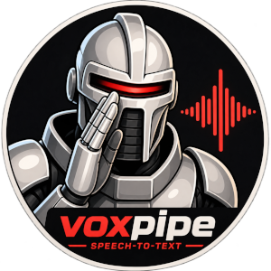

# VoxPipe

Yet another Speech-to-Text console application. Developed and tested on Linux only.

Built with [Go](https://go.dev), [whisper.cpp](https://github.com/ggml-org/whisper.cpp), [malgo](https://github.com/gen2brain/malgo), [ydotool](https://github.com/ReimuNotMoe/ydotool), and [Claude Code](https://claude.com/product/claude-code). Ported from the original C# PvWhisper.

Why make yet another Speech-to-Text program? It was fun, I wanted it to run from a console, and it supports multiple outputs.



## Features

- **Write to Console**
  - Prints transcribed Speech-to-Text to the console

- **Write to Clipboard**
  - Copies transcribed Speech-to-Text to the system clipboard  
  - Requires `wl-copy` (wl-clipboard), `xclip`, or `xsel`

- **Write to Virtual Keyboard (ydotool)**
  - Types transcribed Speech-to-Text into a virtual keyboard  
  - Only available on Linux with [ydotool](https://github.com/ReimuNotMoe/ydotool)

- **Use any Whisper Model**
  - Multiple [Whisper Model](https://whisper-api.com/blog/models/) sizes supported
  - Automatically downloads models from [Hugging Face](https://huggingface.co/openai/models)

- **Toggle speech capture via HTTP**
  - Create a global shortcut to toggle speech capture via shell script

- **Text transformations with Regular Expressions**
  - Create any number of transform rules
  - Use plain text or regular expressions

## Getting Started

1. Install Go 1.24+ and build tools: `sudo apt install build-essential cmake libasound2-dev`
2. Optional: ydotool and keyd (see sections below)
3. Clone with submodules: `git clone --recurse-submodules <repo>` (or `git submodule update --init --recursive`)
4. Configure via `config.toml`: copy `config.example.toml` to `config.toml` and edit it (`scripts/run_voxpipe.sh` does this copy for you on first run)
5. Build with `make build` (the first build compiles whisper.cpp, which takes a minute or two)
6. Execute `scripts/run_voxpipe.sh`, which runs the prebuilt `bin/voxpipe`
7. Toggle capture by executing `scripts/toggle_voxpipe.sh`

`make build` produces `bin/voxpipe`; you can also run it directly from the directory holding `config.toml`. Use `make test` rather than `go test` so cgo finds whisper.cpp; `make test-race`, `make vet` and `make lint` are what CI runs.

## Configuration

Configuration is a [TOML](https://toml.io) file. The search order is `--config <path>`, then `./config.toml`, then `~/.config/voxpipe/config.toml` (`$XDG_CONFIG_HOME`). `config.example.toml` documents every option; unknown keys are rejected so typos are caught at startup.

Write regexes as single-quoted TOML literal strings so backslashes need no escaping: `find = '\b(gira)\b'`.

Supported Outputs (case-insensitive):
- `Console`
- `Clipboard`
- `Ydotool`

Supported `modelType` values: `Tiny`, `Base`, `Small`, `Medium`, `Large`.

`deviceName` is a case-insensitive substring of the input device name; `deviceIndex` is the fallback (`-1` is the system default).

Text transformations run in the order provided. Regex rules use .NET-style syntax and may reference groups in `replace` as `{1}`, `{1:ToUpper}`, `{1:ToLower}`.

## Commands

Console Commands:
- `v` = toggle capture (start/stop + transcribe)
- `c` = start capture
- `z` = stop capture and discard audio
- `x` = stop capture and transcribe
- `q` = quit

Via HTTP (when `httpPort` is set in `config.toml`):
- `curl -s -X POST http://localhost:5042/command/v`   # toggle capture
- `curl -s -X POST http://localhost:5042/command/q`   # quit

## Optional Integrations

### ydotool

Adds support to type via virtual keyboard. *Only available on Linux.*

Instructions for installing ydotool taken from [this issue on official GitHub repository](https://github.com/ReimuNotMoe/ydotool/issues/285#issuecomment-3219166315).

```bash
sudo apt install cmake scdoc pkg-config

cd ~/Downloads/;
git clone https://github.com/ReimuNotMoe/ydotool.git && {
  cd ydotool; mkdir build; cd build && {
    cmake .. && make -j `nproc`;
  };
};
sudo make install;

# DO NOT INSTALL SERVICE
# systemctl daemon-reload;
# systemctl --user enable ydotoold;
# systemctl --user start ydotoold.service;
```

The service requires root. Either run `scripts/start_ydotoold.sh` before starting VoxPipe, or let `scripts/run_voxpipe.sh` offer to start it with sudo (the daemon keeps running after VoxPipe exits; stop it with `sudo pkill ydotoold`).

### keyd

Adds support to override keyboard mappings. *Only available on Linux.*

Instructions for installing keyd taken from [official GitHub repository](https://github.com/rvaiya/keyd?tab=readme-ov-file#from-source).

```bash
git clone https://github.com/rvaiya/keyd
cd keyd
make && sudo make install
sudo systemctl enable --now keyd
```

My configuration (`/etc/keyd/default.conf`) remaps Caps Lock to a global shortcut that invokes toggle script (`scripts/toggle_voxpipe.sh`)

```
[ids]

*

[main]

capslock = macro(leftcontrol+leftalt+leftshift+v)

[control]

capslock = capslock
```

## License

Copyright (C) 2025-2026 tdupont750

Released under the GNU General Public License v3.0. See [LICENSE](LICENSE).
